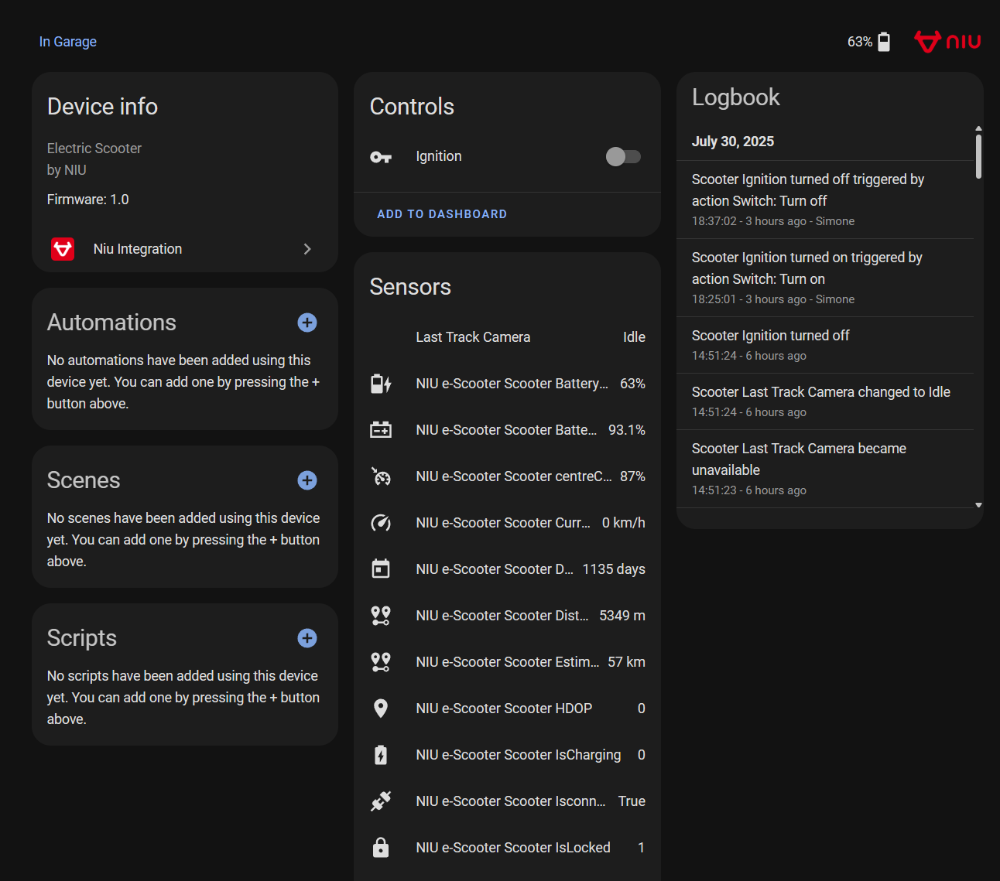
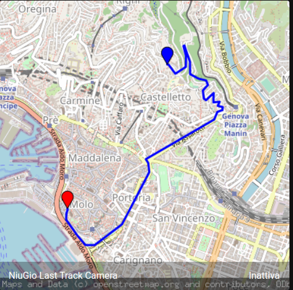
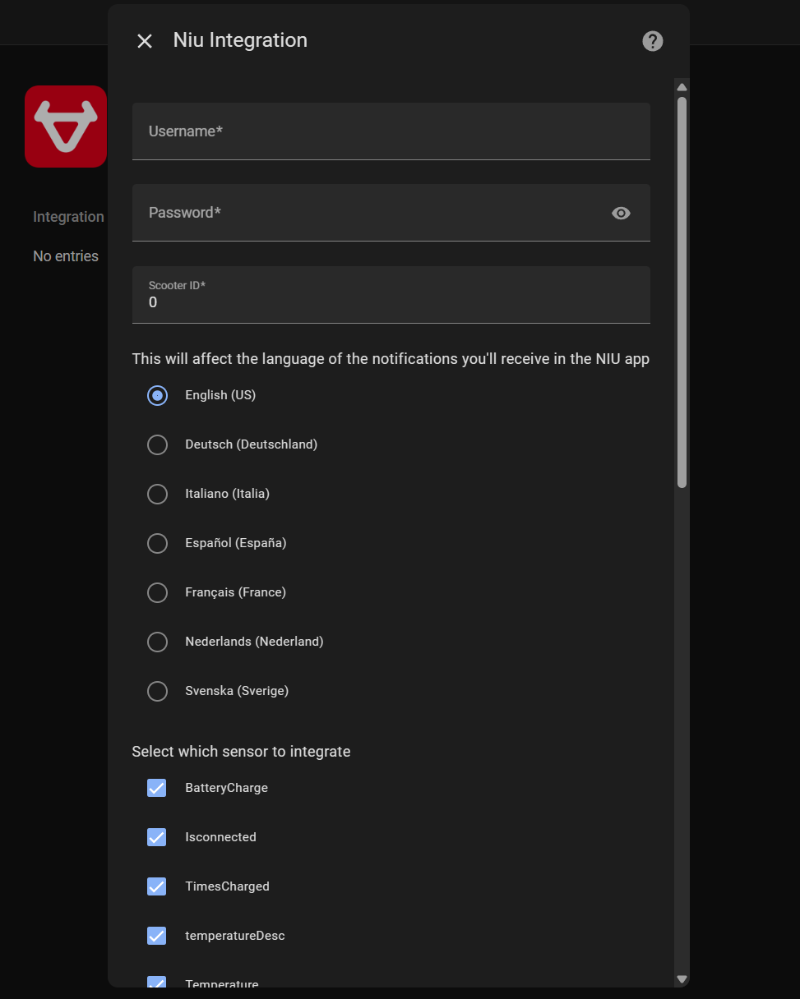

# NIU E-scooter Home Assistant integration

This is a custom component for Home Assistant to integrate your NIU Scooter.

The integration can be setup from the GUI.

## Features:

- You can select which sensors to fetch from NIU's APIs
- You can turn your scooter on and off directly from Home Assistant
- If you enable the Last Track sensor you'll get a camera entity that will show your scooter's last track
- Accounts with multiple scooters can create a separate, serial-number-pinned entry for each scooter
- Dual-battery and TPMS entities are added only when those values are present in NIU's payload for the scooter

## Changes:

- The integration will now ask you to setup a language as this affects the language of the notifications that NIU will send on their mobile apps
- Instead of getting a token for each request to NIU's APIs we now store it and renew it only when it is necessary, hopefully this means we'll be able to incur less in rate limiting
- You will now be able to turn your scooter on and off directly from Home Assistant
- Entities are now created from scooter metadata first and then refreshed through one shared update cycle, which avoids startup template failures caused by late entity registration
- Transient API failures now keep the last known-good sensor values instead of resetting entities to unknown when NIU returns partial or missing payloads
- Sensors, switch, and camera entities are grouped under the scooter device automatically
- Ignition commands are confirmed with short-lived targeted polling, while Home Assistant keeps showing the previous state until NIU reports that the command has completed
- NIU requests use Home Assistant's shared asynchronous client with explicit timeouts, token recovery, rate-limit backoff, and user-visible authentication errors
- Only the NIU endpoints required by the enabled entities are polled; motor status remains enabled for ignition confirmation
- The last-track image now uses a native cached camera entity with response validation and privacy-safe logging

## Some pictures:

### Device example

### Camera entity

With the thanks to pikka97 !!!

## Setup

1. In Home Assistant's settings under "Device and services" click on the "Add integration" button.
2. Search for "NIU Scooters" and click on it.
3. Enter your NIU app credentials and notification language.
4. Choose a scooter from the vehicles returned by your account, then select the sensors you'd like to enable.
5. Repeat the setup flow if you want a separate entry for another scooter.

Notes:

- Leaving all sensors unselected no longer blocks setup; the ignition switch can still load on its own.
- Sensor, switch, and camera state now come from a shared snapshot, so entities update together more consistently.
- Existing entries are migrated automatically from their old vehicle-list index to the scooter's stable serial number.
- New entries leave GPS coordinates and ride-history entities disabled by default; they remain available from the integration options.
- Existing primary-battery selections automatically gain their matching battery-B entity on dual-battery models.
- For the `niu.set_scooter_ignition` action, select the NIU config entry when more than one scooter is configured. Legacy `scooterId` calls continue to work when they identify exactly one loaded entry.

## Known bugs

None but if you encounter any please let me know
